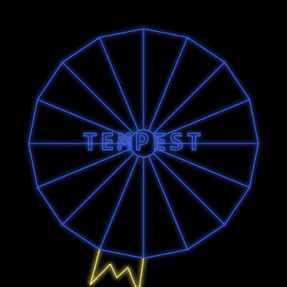

<div align="center">

# ⚡ T E M P E S T ⚡

### *Climb the tube. Blast the things climbing toward you. Try not to scream.*



**One HTML file. Zero dependencies. Infinite neon.**

</div>

---

## 🕹️ Play it

No install, no build, no 400 MB `node_modules` (yet). Just open the file:

```bash
# the lazy way
open index.html          # or double-click it, we won't judge

# the "I have a server fetish" way
npx serve .
```

## 🎮 Controls

| What you want to do        | Keyboard                               | Pointer                     |
| -------------------------- | -------------------------------------- | --------------------------- |
| Scoot around the rim       | `←` `→` or `A` `D`                     | Move the mouse / drag a finger |
| Pew pew                    | `Space`, `Enter`, `↑` `↓`, `W` `S`     | Click / hold / tap          |
| Start the game             | Literally any of the above             | Click anywhere              |

Fire is auto-repeat: hold it down and let the claw sing. Your claw snaps to whichever lane your pointer is nearest to, so waving a mouse around like a conductor is a legitimate strategy.

## 🌀 What's in the box

- **Five web shapes** - circle, square, cross, flat plane and a V - cycling as you progress.
- **Six neon colour schemes**, because the tube deserves a mood ring.
- **Vector-style glow** drawn with canvas strokes and `shadowBlur`. No sprites. No textures. No cheating.
- **Synthesised sound** via the Web Audio API. Every beep and zap is an oscillator, not a sample.
- **Keyboard *and* pointer input**, so it works on a laptop, a desktop, or a phone you're not supposed to be playing on at work.

## 📼 A brief and mostly accurate history of Tempest

**1981.** Atari releases *Tempest* into arcades, where it promptly eats a generation's pocket money.

**The nightmare.** Designer **Dave Theurer** (the mind behind *Missile Command*) has said the game was inspired by a recurring nightmare: monsters crawling up out of a hole in the ground toward him. He then did what any healthy person would do and turned it into a product. Players have been having the same nightmare ever since, but with a coin slot.

**The tech.** Tempest was among the first arcade games to use **colour vector graphics**. Where most vector games of the era (*Asteroids*, *Lunar Lander*) were stuck with glowing white lines, Tempest brought a full rainbow of crisp lines on a dark screen, driven by Atari's *Color-QuickDraw* hardware. It looks like a wireframe dream because it *is* one.

**The twist.** Instead of a flat screen, you live on the rim of a 3D "web" - a tube, a square, a plane, a V - and move *around* its edge, shooting down the lanes at enemies climbing up from the far end. Think *Space Invaders*, if the invaders came at you through a drainpipe.

**The cast of nasties.** Flippers that tumble up the lanes and, if they reach you, drag you off. Tankers that split into more Flippers because one problem was never enough. Spikers that lay trails of spikes you have to shoot through. Fuseballs that zig-zag across lanes. Pulsars that electrify the lane you're standing in. And a **Superzapper** - a once-per-level "make it all go away" button that has saved more high scores than any therapist.

**The knob.** Instead of a joystick, Tempest uses a **spinner** - a heavy, smooth, free-spinning knob. If you've never played with one, imagine the best volume dial you've ever turned, but it fires lasers. It's why a lot of people still insist the original cabinet is the only *real* way to play it.

**The legacy.** *Tempest* got sequels and reinventions: *Tempest 2000* (1994, Jeff Minter, Atari Jaguar) added a techno soundtrack and a fresh coat of psychedelia; *Tempest 3000* and *Tempest 4000* kept the tube spinning for later generations. Dave Theurer's nightmare, it turns out, was extremely good game design.

> *This is a fan-made, from-scratch homage. It is not affiliated with Atari or the original creators.* ❤️

## 🛠️ Under the hood

The whole game lives in [`index.html`](index.html):

- **Web geometry** - each web is a list of lane points, projected from a near rim to a shrunken far rim so that flat polygons look like they're falling away into the screen.
- **Simulation** - player, bullets, enemies, spawning and difficulty all tick in one small loop.
- **Rendering** - plain 2D canvas strokes with a glow. No WebGL, no libraries.
- **Audio** - a tiny `sfx(f0, f1, d)` helper sweeps an oscillator from one frequency to another. That's the whole sound department.

## 🗺️ Roadmap

The next wave of work is laid out in [`specs/`](specs/) and tracked in [`IMPLEMENTATION_PLAN.md`](IMPLEMENTATION_PLAN.md):

- [ ] Real test tooling (Vitest, ESLint, Prettier) and pure, DOM-free game logic
- [ ] More webs and a proper level progression
- [ ] More enemy types and nastier behaviour
- [ ] Scoring and persistent high scores
- [ ] Richer audio and effects

## 🤖 How it's built

This repo is set up for an autonomous "Ralph Wiggum" build loop (`loop.sh` / `loop.ps1`, `PROMPT_*.md`, `AGENTS.md`): plan the work, build one task at a time, run the checks, repeat. The game is a toy; the process is the other toy.

---

<div align="center">

*Insert coin. Spin knob. Survive.* 🪙

</div>
